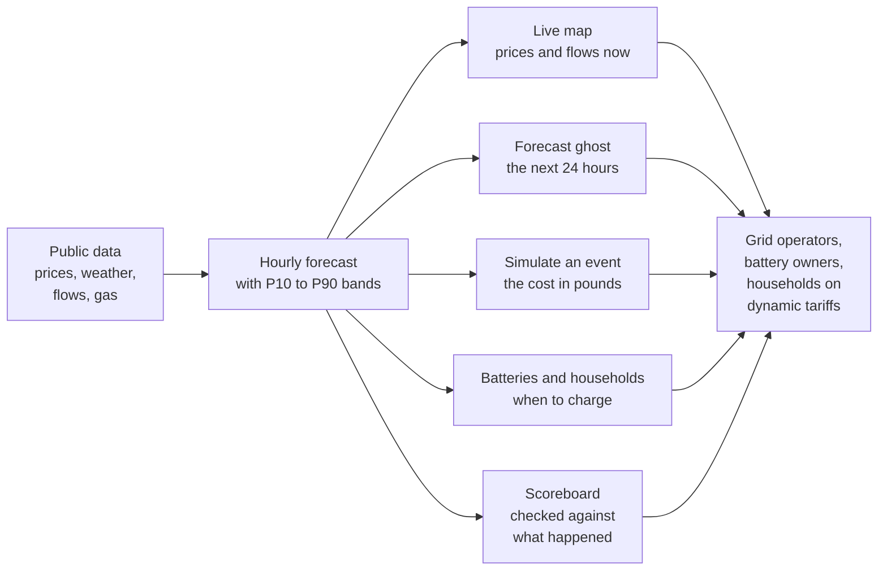
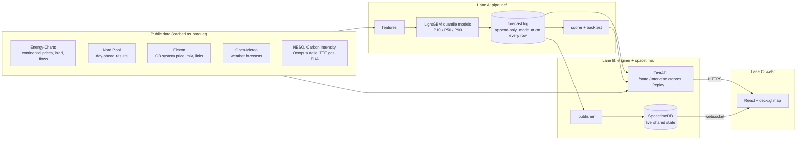
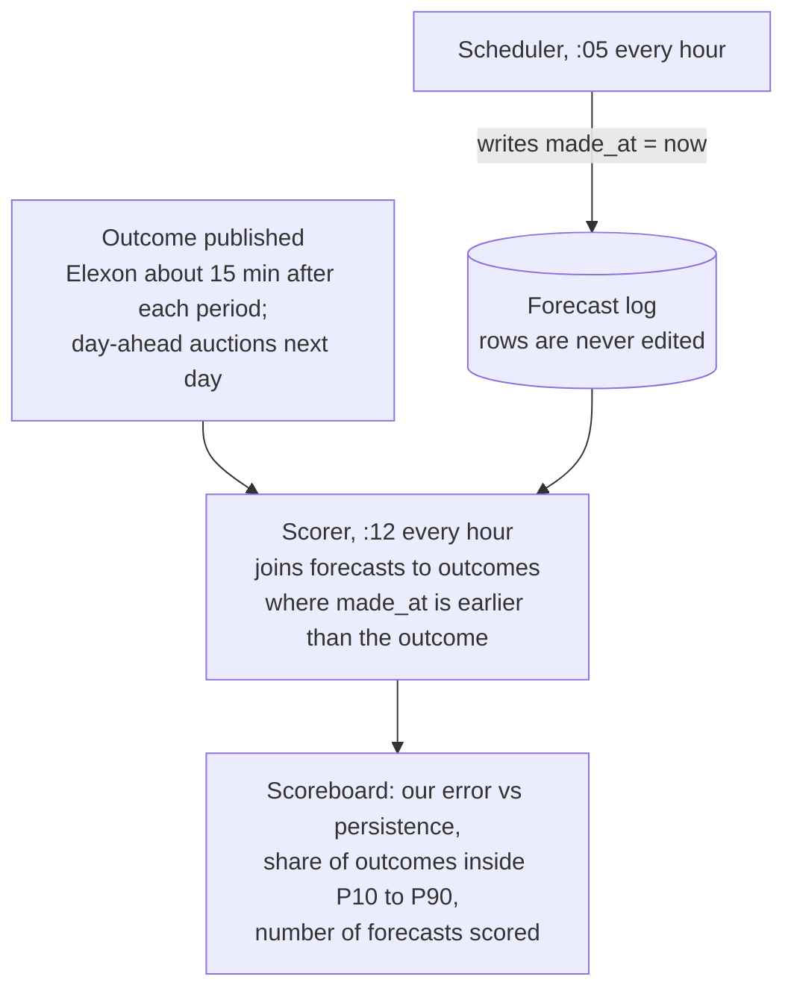

# The Living Grid

Europe's electricity market, live, with a forecast you can check.

Built at HackTheBurgh XIII (7-8 November 2026) for the HRT track "Best Use of Data for Predictions and Decision Making" and the G-Research track "Making the Unseen Seen".

**Live:** https://htb.stefvuck.dev

Power prices move for reasons you can't see: wind that gets paid to switch off, gas setting the price in GB most hours, cables between countries running flat out. So we put six zones on one map, forecast where prices are heading with honest uncertainty bands, and let you break things (close the Strait of Hormuz, trip the Norway cable) to see what it costs. Every forecast gets scored against what actually happened. Including the ones we got wrong.

## At a glance



The map shows GB, France, Germany-Luxembourg, the Netherlands, Belgium and southern Norway (NO2), coloured by this hour's day-ahead price, with arcs for electricity moving through the interconnectors. On the evening of 7 November that was £268/MWh in GB, €322 across the four coupled continental zones and €205 in NO2.

- **Overview:** this hour's price, demand, generation mix, carbon intensity and flows for each zone.
- **Forecast:** a translucent ghost of where prices are heading over the next 24 hours. The P10 to P90 band gets wider the further out you look.
- **Simulate:** pick an event, see what it costs in pounds or euros and which zones take the hit.
- **Scoreboard:** our forecasts against simple guesses. Only forecasts logged before the outcome count.
- **Batteries:** a 1 MW / 2 MWh battery in each zone trading on our forecasts, against a naive rule and against perfect foresight.
- **Replay:** the 26 October storm, played back by a model that never saw that day.
- **Household:** the cheapest window tonight to charge your car or run the dishwasher.

## How it works

### Who built what

Three of us, three lanes: Stefan (data and models), Keanu (engine and live state) and Manu (front end and demo).



Python pulls every source and caches it as parquet. At five past each hour the scheduler builds features, runs the model and appends to the forecast log. FastAPI answers the questions ("what was the state at 15:00?", "what if Norway's cable trips?"). Once a minute the publisher pushes actuals, forecasts, scores and battery runs into SpacetimeDB, so every screen updates together.

### How forecasts are scored

A forecast only counts if it was logged before the result was published. Every row has a `made_at` timestamp and the scorer ignores anything later.



Monday's forecast freezes at 09:15 UTC on Sunday, before the GB auction (09:50 UTC) and the continental one (11:00 UTC) close. It meets the real result in the 12:30 demo.

### Results

Walk-forward backtest, six folds of seven days with a 48-hour purge, run on 7 November 2026 at 16:35 UTC:

| Model | Day-ahead price error (MAE) |
|---|---|
| Our LightGBM quantile model | **31.6** |
| Same hour yesterday | 36.8 |
| Last known price when the forecast was made (persistence) | 43.7 |

That's 28% better than persistence on day-ahead prices. We lose to persistence on NO2 prices and French wind, and the backtest says so.

The bands are too narrow. Across the backtest 63% of outcomes landed between P10 and P90, where a calibrated model would catch 80%. Two single-day replays show where:

| Day | Hours inside the band |
|---|---|
| 2 November 2026 (calm) | 136 of 168 (81%) |
| 26 October 2026 (storm) | 83 of 168 (49%) |

The storm caught the model out. NESO puts GB constraint costs that day at £36.5m. Recalibrating the bands is in progress.

### Events you can trigger

| Event | What it changes |
|---|---|
| Strait of Hormuz closes | Raises the gas price; power prices follow through a merit-order estimate where gas sets the price |
| Norway to GB link trips | Removes the link's recent flow: GB residual load rises, Norway's falls |
| French nuclear outage | Removes reactors (default four 1,450 MW units, capped at the 63 GW fleet) |
| North Sea storm or windless week | Scales wind through a turbine power curve (cut-in 3, rated 12, cut-out 25 m/s) |
| Cold snap | Lowers temperature; French demand rises 2,400 MW per degree, RTE's own figure |
| Carbon price spike | Raises the EUA price and passes it through gas plants at 0.334 tCO₂/MWh |
| Storm over Scotland | More Scottish wind than the 6.7 GW B6 boundary can carry: prices fall, but more wind is paid to switch off |

The model has two years of history and has never seen anything like Hormuz closing, so that one uses the merit order instead: a gas plant at 58% efficiency burns 1.72 MWh of gas per MWh of power. The screen says it's an approximation of market coupling, because it is.

### Where the numbers come from

Every constant in the engine (interconnector capacities, plant efficiencies, emission factors, wind farm sizes, boundary limits) lives in `engine/reference/facts/` with its source URL, the exact quote and a confidence rating. Each one was researched with the Parallel Task API, checked by a second independent run, then re-found on the source page with a plain HTTP fetch. 51 of 53 pass. The other two are flagged and the code won't load them.

| Source | Used for | Limit we respect |
|---|---|---|
| Energy-Charts | Continental prices, load, generation, flows | 2 requests per minute per endpoint |
| Nord Pool | Day-ahead prices, including GB (N2EX) | About 60 days of history on the free API |
| Elexon Insights | GB system price, generation mix, interconnector flows, wind curtailment | 7-day windows |
| Open-Meteo | Historical and live weather forecasts | 10,000 calls a day |
| NESO | Constraint costs, boundary flows | Costs arrive about a week late |
| Carbon Intensity API | GB regional carbon intensity | Modelled data, labelled as such |
| Octopus Agile | Household tariff prices | Next day published around 16:00 UK |
| Yahoo Finance | TTF gas and EUA carbon prices | Daily closes, refreshed each hourly run |

### Known limits

- The P10 to P90 bands are too narrow (see above).
- Energy-Charts gives load for all of Norway, not just NO2 (15.3 GW against roughly 5 GW), so NO2 demand is left blank.
- Ghost wind (wind paid to switch off) is worked out two ways: from accepted balancing bids, and from the gap between weather-implied and metered output. Both are labelled as estimates.
- Carbon in imported power uses standard emission factors per fuel, not plant-level data.

### Deliberately not built

- Accounts or OAuth. Judges join from a QR code in a few seconds, and SpacetimeDB already gives every phone its own anonymous identity.
- Plant-level carbon. The data isn't public in real time.

### Running it locally

```bash
uv sync                                    # Python 3.12, fetched by uv
uv run uvicorn engine.app:app --port 8000  # API
cd web && npm install && npm run dev       # front end on :5173
./scripts/check.sh                         # tests, then the web build (the merge gate)
```

`LG_OFFLINE=1` runs the whole thing from cached files and committed fixtures with no network. The demo has to survive the venue Wi-Fi dying.

### How we built it

Each of us ran one to three Claude Code agents on a Hetzner VPS. They took tasks off a shared board (hackhub, see [HACKHUB.md](HACKHUB.md)), each task locked to the files it claimed, and a merge queue landed them one at a time only when the tests and the web build passed. Agents in different lanes talked over an ntfy message bus. Main mirrored to GitHub every minute. By 16:40 on Saturday that had merged 63 of 89 tasks.

Stack: Python 3.12 with pandas, LightGBM and FastAPI; SpacetimeDB 2.14 for live state; React, Vite, deck.gl 9.4 and MapLibre 5.24 for the map.
