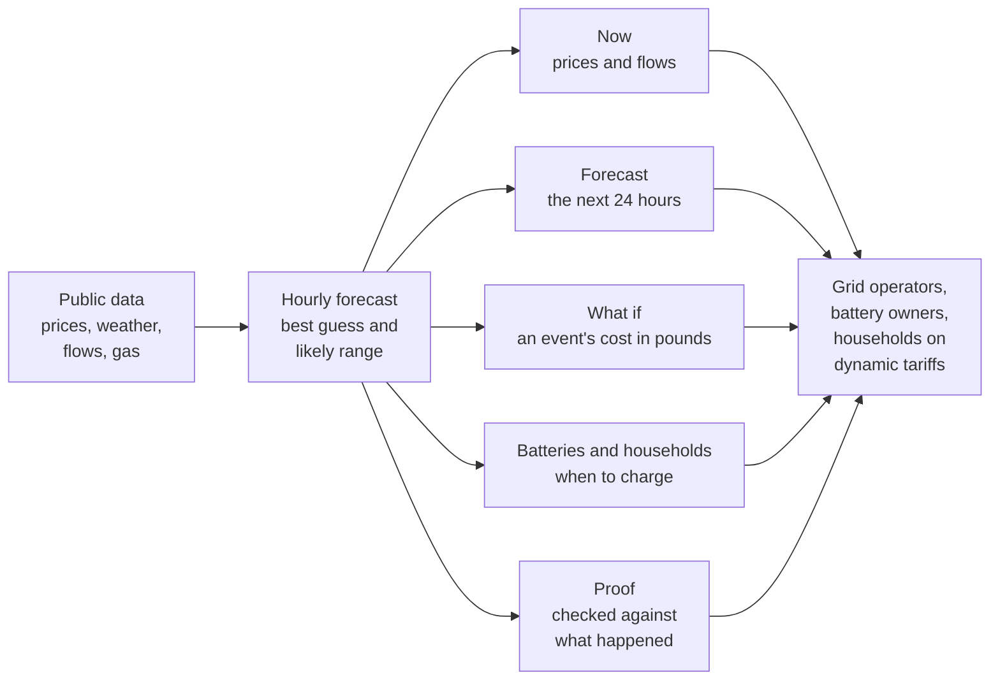
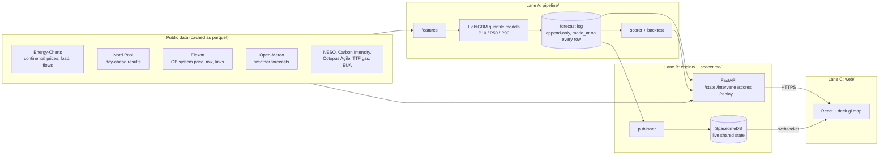
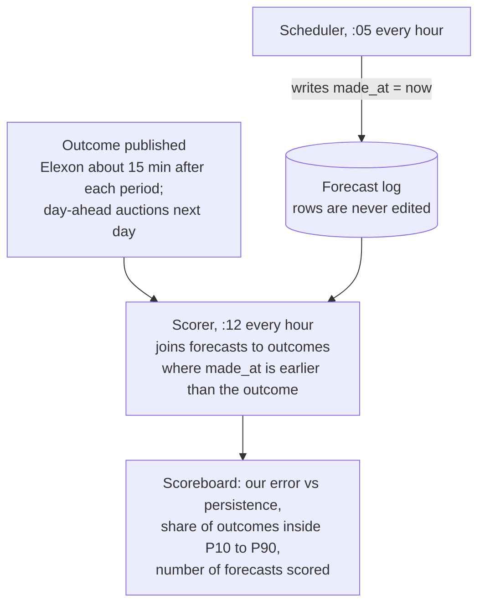

# The Living Grid

Europe's electricity market, live, with a forecast you can check.

Built at HackTheBurgh XIII (7-8 November 2026) for the HRT track "Best Use of Data for Predictions and Decision Making" and the G-Research track "Making the Unseen Seen".

**Live:** https://htb.stefvuck.dev

Power prices move for reasons you can't see: wind that gets paid to switch off, gas setting the price in GB most hours, cables between countries running flat out. So we put six zones on one map, forecast where prices are heading with a best guess and a likely range around it, and let you break things (close the Strait of Hormuz, trip the Norway cable) to see what it costs. Every forecast gets scored against what actually happened. Including the ones we got wrong.

## At a glance



The map shows GB, France, Germany-Luxembourg, the Netherlands, Belgium and southern Norway (NO2), coloured by this hour's day-ahead price, with arcs for electricity moving through the interconnectors (the cables that link one country's grid to another's). The day-ahead price is set in an auction the day before, and it's what we forecast. On the evening of 7 November that was £268/MWh in GB, €322 across the four coupled continental zones and €205 in NO2. A megawatt-hour (MWh) is 1,000 kWh, the unit on your bill. These are wholesale prices: what energy suppliers pay. A household bill adds network costs and other charges, and only follows wholesale changes later.

- **Now:** this hour's price, demand, generation mix, carbon intensity and flows for each zone.
- **Forecast:** where prices are heading over the next 24 hours. The faint block on the map is our forecast; the fainter it is, the less sure we are. It shows our best guess (the single most likely price) and a likely range around it (P10 to P90), which should hold the real price 8 times out of 10. The range gets wider the further out you look.
- **Hidden grid:** Scottish wind paid to switch off when a boundary is full (a boundary is the group of power lines between two areas, such as Scotland and England), and the constraint cost: what the grid pays generators on each side of a full line, which ends up on everyone's bills.
- **What if:** pick an event, see what it costs in pounds or euros and which zones take the hit.
- **Proof:** our forecasts against simple guesses, such as persistence: assume the price stays where it was when the forecast was made. Only forecasts logged before the outcome count. Each frozen forecast has a fingerprint, a short code from the forecast file that changes completely if one digit does, posted on a public blockchain so anyone can check we did not change it.
- **Batteries:** a 1 MW / 2 MWh battery in each zone trading on our forecasts, against a naive rule and against perfect foresight.
- **Replay:** the 26 October storm, played back by a model that never saw that day.
- **Household:** the cheapest window tonight to charge your car or run the dishwasher.

## How it works

### Who built what

Three of us, three lanes: Stefan (data and models), Keanu (engine and live state) and Manu (front end and demo).



Python pulls every source and caches it as parquet. At five past each hour the scheduler builds features, runs the model and appends to the forecast log. FastAPI answers the questions ("what was the state at 15:00?", "what if Norway's cable trips?"). Once a minute the publisher pushes actuals, forecasts, scores and battery runs into SpacetimeDB, so every screen updates together.

### How forecasts are scored

A forecast only counts if it was logged before the result was published. Every row has a `made_at` timestamp and the scorer ignores anything later.



Monday's forecast freezes at 09:15 UTC on Sunday, before the GB auction (09:50 UTC) and the continental one (11:00 UTC) close. It meets the real result in the 12:30 demo.

### On-chain proof that forecasts were not changed

Each frozen forecast, and each hourly run, is hashed with SHA-256 and the hash is posted to Solana (**devnet**, so a network reset can erase it) as a Memo-program transaction from one published wallet:

`FYgaqPzTFtMhdJU7DSx3pt65bsH76W17K4WixM6XfS2x` ([every transaction](https://explorer.solana.com/address/FYgaqPzTFtMhdJU7DSx3pt65bsH76W17K4WixM6XfS2x?cluster=devnet))

This is our second wallet. We retired the first, `H82mxBj3HeSsgUpz1xSgxeteQquSvk4HvFyiUE8sc8Gv`, on 7 November 2026 because a test run on a developer account posted about 66 junk memos to it, some labelled with future freeze times, so its history no longer proves anything. Its two real commitments are the freeze at 20:00 UTC (transaction `4fCxKkxHLnRXbUsP7UDJaFB9rCkaxBjHRqXhdF6k7tDV8wyMCgDtmEYbX4WZpMuVM1sc2Qr5A2rXWNHuPs1XKJeF`) and the hourly run at 20:05 UTC (`5YddW2t167bUtrKv6f9ShpXcME1LCAZS1bCoThRQ2YFg1LGqx4pDu3dfQWgesfPfe8p6zZE4J4B4DDnTApkbLpAr`). We moved its balance to the new wallet in a plain transfer. Only the scheduled jobs hold the key, and the code refuses to post under pytest or without an explicit key path.

The memo reads `lg1|<freeze or run>|<UTC time>|<sha256>`. The hashed bytes are the canonical CSV in `data/commitments/` (header, rows sorted by every column, UTC times ending in Z, floats as Python prints them). A hash proves a forecast existed unchanged at that time; it cannot prove we did not post others, so the wallet's full history is the check. `python -m pipeline.commit_chain verify` recomputes the hashes and reads the memos back. Code: `pipeline/commit_chain.py`.

### Results

These numbers come from a backtest: the model is tested on past weeks it never saw while it was being built, as if it were forecasting them live. The error (MAE) is the average gap between our best guess and the real price; lower is better. The app's Proof section may show live scored figures instead, with their own basis (#285 labels which); the figures below are the backtest.

Walk-forward backtest, six folds of seven days with a 48-hour purge, run on 7 November 2026 at about 23:45 UTC on main at `2919ad8`, with the split-conformal band calibration (#92) fitted per fold on held-out training rows. Source: `data/backtest/walk_forward.parquet`.

| Model | Day-ahead price error (MAE) |
|---|---|
| Our LightGBM quantile model | **33.0** |
| Same hour yesterday | 36.6 |
| Last known price when the forecast was made (persistence) | 43.2 |

That's 24% better than persistence on day-ahead prices, pooled over all six zones (6,039 hours). Per zone the model beats persistence everywhere except NO2 (ratio 1.12) and beats yesterday in four of six zones. It loses to yesterday in France and to both baselines in NO2. Across all 17 zone-and-target pairs it beats both baselines in 13; the losses are NL load against yesterday (an Energy-Charts data break on 10 October), FR price against yesterday, NO2 price against both, and FR wind against persistence.

The bands are closer to honest but still a little narrow. After calibration 79.9% of day-ahead price outcomes landed inside the likely range, between P10 and P90 (target 80%; 63.3% in the 16:53 run without it). By target: day-ahead price 79.9%, load 80.2%, wind 77.1%, GB system price 73.6%.

The replay of 26 October 2026, a stormy day, generated separately from the backtest, shows where the misses cluster: 78 of its 168 hours (46%) landed inside the likely range. The storm caught the model out. NESO puts GB constraint costs that day at £36.5m.

### Bot league: which technique wins, and when

Four rival forecasters run on exactly the same backtest rows as ours, each trained only on data from before the week it forecasts: **Yesterday** and **Last week** (same hour a day or a week earlier, with a band from their own past errors), **The Engineer** (merit order: price from residual load, gas and carbon) and **The Committee** (a weighted blend of the others, then calibrated). Storm days are the windiest 15% of days by GB wind output: 6 of the 43 days, 26 October among them. Run on 7 November at 20:57 UTC in an agent's worktree, not on the runner; `python -m pipeline.bot_league` reproduces it into `data/backtest/bot_league.json` in about 14 minutes.

Day-ahead prices (MAE in £ or €/MWh; pinball loss scores the whole P10 to P90 band; lower is better):

| Model | MAE, calm | MAE, storm | Pinball, all | Inside P10 to P90 |
|---|---|---|---|---|
| The Committee | **29.9** | 46.0 | **11.5** | 83% |
| Our model | 30.5 | **43.2** | 11.6 | 78% |
| Yesterday | 32.0 | 64.5 | 12.8 | 81% |
| The Engineer | 79.1 | 46.6 | 19.6 | 74% |
| Last week | 62.0 | 83.0 | 21.8 | 71% |
| Persistence (no band) | 40.6 | 59.0 | | |

- **On day-ahead prices it's a tie.** The Committee edges us on pinball loss, but a Diebold-Mariano test on the hourly errors can't tell us apart (p = 0.94). We beat persistence clearly (p < 0.001).
- **On GB system price we come out on top:** the best Brier score in every regime, and the lowest pinball loss overall and in storms (level with the Committee on calm days). The Committee's MAE is slightly lower overall (42.5 against 43.1), and the difference isn't significant (p = 0.61).
- **The Engineer is the storm specialist.** It is worst of the four on calm days (79.1) and nearly level with us in storms (46.6 against 43.2, no significant difference), because that's when wind and gas really do set the price.
- **Yesterday is fine until the weather turns.** On calm days we can't beat it significantly (p = 0.62); in storms its error doubles and its band catches only 57% of outcomes.
- **Yes/no questions:** asked "will the price be above its average of the past week?" every hour, our model has the best Brier score in storms (0.129 on day-ahead prices) and the Committee in calm weather (0.146 against our 0.155). A forecast with no band is always sure of itself, and it shows: the same-hour-yesterday guess scores 0.222 on its own and 0.168 once the Yesterday bot adds a band from its past errors.

Every band is still too narrow in storms: the best catch 66% to 72% of outcomes, against the 80% target.

### Events you can trigger

| Event | What it changes |
|---|---|
| Strait of Hormuz closes | Raises the gas price; power prices follow through a merit-order estimate where gas sets the price |
| Norway to GB link trips | Removes the link's recent flow: GB residual load rises, Norway's falls |
| French nuclear outage | Removes reactors (default four 1,450 MW units, capped at the 63 GW fleet) |
| North Sea storm or windless week | Scales wind through a turbine power curve (cut-in 3, rated 12, cut-out 25 m/s) |
| Cold snap | Lowers temperature; French demand rises 2,400 MW per degree, RTE's own figure |
| Carbon price spike | Raises the EUA price and passes it through gas plants at 0.334 tCO₂/MWh |
| Storm over Scotland | More Scottish wind than the 6.7 GW B6 boundary can carry: prices fall, but more wind is paid to switch off |

The model has two years of history and has never seen anything like Hormuz closing, so that one uses the merit order instead: a gas plant at 58% efficiency burns 1.72 MWh of gas per MWh of power. The screen says it's an approximation of market coupling.

### Where the numbers come from

Every constant in the engine (interconnector capacities, plant efficiencies, emission factors, wind farm sizes, boundary limits) lives in `engine/reference/facts/` with its source URL, the exact quote and a confidence rating. 53 of them were researched with the Parallel Task API, checked by a second independent run, then re-found on the source page with a plain HTTP fetch; 51 of those pass, and the other two are flagged and the code won't load them. Six more (data-centre hardware and household figures) were entered by hand with their source.

| Source | Used for | Limit we respect |
|---|---|---|
| Energy-Charts | Continental prices, load, generation, flows | 2 requests per minute per endpoint |
| Nord Pool | Day-ahead prices, including GB (N2EX) | About 60 days of history on the free API |
| Elexon Insights | GB system price, generation mix, interconnector flows, wind curtailment | 7-day windows |
| Open-Meteo | Historical and live weather forecasts | 10,000 calls a day |
| NESO | Constraint costs, boundary flows | Costs arrive about a week late |
| Carbon Intensity API | GB regional carbon intensity | Modelled data, labelled as such |
| Octopus Agile | Household tariff prices | Next day published around 16:00 UK |
| Yahoo Finance | TTF gas and EUA carbon prices | Daily closes, refreshed each hourly run |

### Known limits

- The P10 to P90 bands are still slightly narrow for GB system price and wind (see above).
- Energy-Charts reports load and wind for all of Norway, not just price zone NO2 (load averages about 15 GW against roughly 5 GW for NO2). So the load and wind forecasts cover five zones (GB, FR, DE-LU, NL, BE) and leave NO2 out, rather than log Norway-wide numbers under an NO2 label. Day-ahead prices cover all six zones, and each hourly run logs 816 forecasts instead of 912.
- Ghost wind (wind paid to switch off) is worked out two ways: from accepted balancing bids, and from the gap between weather-implied and metered output. Both are labelled as estimates.
- Carbon in imported power uses standard emission factors per fuel, not plant-level data.
- The 6.7 GW we use for the Scotland-England boundary (B6) is NESO's planning capability: "The boundary capability is limited to 6.7 GW due to thermal constraint on the Harker-Moffat 400kV circuit" ([ETYS 2025](https://www.neso.energy/document/383876/download)). The limit NESO actually runs to is lower and changes daily, because it must secure the worst single fault: "our typical B6 limit is ~6GW but the intact capacity is ~12GW - we always have to operate to secure the worst fault" ([NESO Constraints Collaboration Q&A, Jan 2025](https://www.neso.energy/document/350981/download)). The day-ahead SCOTEX limit we ingest was 3.3 to 3.6 GW on 7 Nov 2026; NESO notes day-ahead limits are sometimes set low when it does not expect the boundary to be congested. The storm scenario uses 6.7 GW, so it understates how often Scotland is cut off.

### Deliberately not built

- Accounts or OAuth. Judges join from a QR code in a few seconds, and SpacetimeDB already gives every phone its own anonymous identity.
- Plant-level carbon. The data isn't public in real time.

### Running it locally

```bash
uv sync                                    # Python 3.12, fetched by uv
uv run uvicorn engine.app:app --port 8000  # API
cd web && npm install && npm run dev       # front end on :5173
./scripts/check.sh                         # tests, then the web build (the merge gate)
```

`LG_OFFLINE=1` runs the whole thing from cached files and committed fixtures with no network. The demo has to survive the venue Wi-Fi dying.

### How we built it

Each of us ran one to three Claude Code agents on a Hetzner VPS. They took tasks off a shared board (hackhub, see [HACKHUB.md](HACKHUB.md)), each task locked to the files it claimed, and a merge queue landed them one at a time only when the tests and the web build passed. Agents in different lanes talked over an ntfy message bus. Main mirrored to GitHub every minute. By 16:40 on Saturday that had merged 63 of 89 tasks.

Stack: Python 3.12 with pandas, LightGBM and FastAPI; SpacetimeDB 2.14 for live state; React, Vite, deck.gl 9.4 and MapLibre 5.24 for the map.
