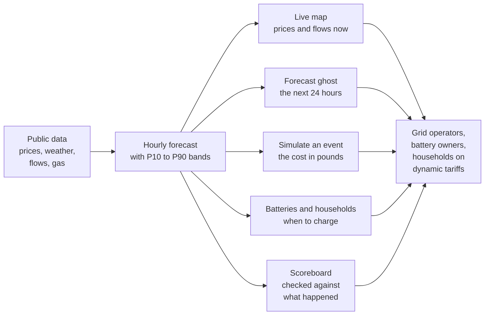
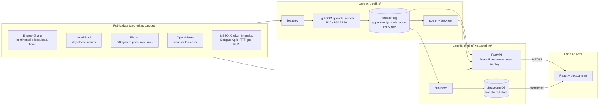
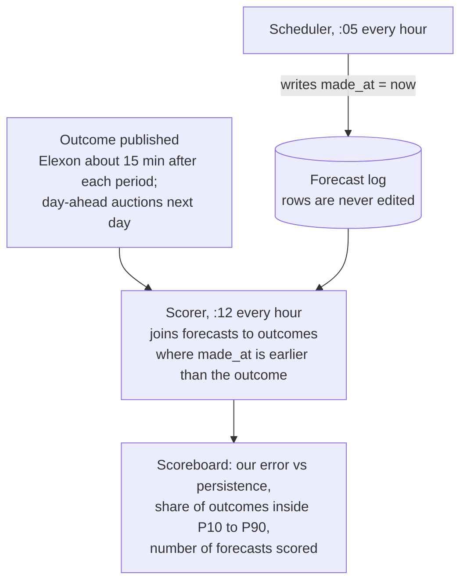

# The Living Grid

Interactive electricity price prediction with uncertainty bounds across six European zones. You can simulate shocks to the market like closing the Strait of Hormuz or tripping the Norway cable. Every prediction is scored against its actual outcome.

Built in 24 hours at HackTheBurgh XIII (7-8 November 2026) for the HRT track "Best Use of Data for Predictions and Decision Making" and the G-Research track "Making the Unseen Seen".

**Live:** https://htb.stefvuck.dev

## At a glance



At the top there's a map of GB, France, Germany-Luxembourg, the Netherlands, Belgium and southern Norway (NO2) showing the day-ahead price for this hour. Arcs between zones show electricity travelling down the interconnectors. On the evening of 7 November the map showed £268/MWh in GB, €322 in each of the coupled continental zones and €205 in NO2.

- **Overview:** the price in each zone this hour, along with demand, generation mix, carbon intensity and interconnector flows.
- **Forecast:** a ghostly projection of where prices are heading over the next 24 hours, with a P10 to P90 range that widens the further ahead you look.
- **Simulate:** what does an event cost, in pounds or euros, and which zones take the hit?
- **Scoreboard:** how well do we forecast compared with a simple guess? Only forecasts logged before the outcome was known count.
- **Batteries:** a 1 MW / 2 MWh battery in every zone runs on our forecasts. How does it compare with a naive rule, or with perfect foresight?
- **Replay:** the storm of 26 October 2026, replayed with a model that had no knowledge of events on or after that date.
- **Household:** when tonight can you charge your car or run the dishwasher for the least money?

## Technical details

### How it fits together

Three developers, three lanes: Stefan (data and models), Keanu (engine and live state) and Manu (front end and demo).



In the back end, Python fetches and caches all data in parquet files. A scheduler runs every hour, five minutes past, and makes the next round of forecasts: feature engineering, model prediction and logging. For questions such as "what was the state at 15:00?" or "what happens if Norway's cable trips?", FastAPI answers through requests and responses. Every minute, a publisher sends the latest actuals, forecasts, forecast scores and battery runs into SpacetimeDB, so every open screen updates at the same time.

### How forecasts are scored

We don't score forecasts that were saved after the result was already in. There's a timestamp on all forecasts and the scorer knows about it.



Monday's forecast freezes at 09:15 UTC on Sunday, before the GB auction (09:50 UTC) and the continental auction (11:00 UTC) close. You'll see it next to the real auction result in the 12:30 demo.

### Results

Walk-forward backtest, six folds of seven days each with a 48-hour purge, run on 7 November 2026 at 16:35 UTC:

| Model | Day-ahead price error (MAE) |
|---|---|
| Our LightGBM quantile model | **31.6** |
| Same hour yesterday | 36.8 |
| Last known price when the forecast was made (persistence) | 43.7 |

The model predicts day-ahead prices 28% better than persistence, but does worse than persistence on NO2 prices and French wind. We don't hide the losses.

The uncertainty bands around these forecasts are currently too narrow. Over the backtest, 63% of outcomes fell between P10 and P90, where a well-calibrated model would catch 80%. Two single-day replays show where it struggles:

| Day | Hours inside the band |
|---|---|
| 2 November 2026 (calm) | 136 of 168 (81%) |
| 26 October 2026 (storm) | 83 of 168 (49%) |

On 26 October, GB constraint costs came to £36.5m according to NESO's data. Work is under way to recalibrate the bands.

### Events you can trigger

| Event | What it changes |
|---|---|
| Strait of Hormuz closes | Raises the gas price; power prices follow through a merit-order estimate where gas sets the price |
| Norway to GB link trips | Removes the link's recent flow: GB residual load rises, Norway's falls |
| French nuclear outage | Removes reactors (default four 1,450 MW units, capped at the 63 GW fleet) |
| North Sea storm or windless week | Scales wind through a turbine power curve (cut-in 3, rated 12, cut-out 25 m/s) |
| Cold snap | Lowers temperature; French demand rises 2,400 MW per degree, RTE's own figure |
| Carbon price spike | Raises the EUA price and passes it through gas plants at 0.334 tCO₂/MWh |
| Storm over Scotland | More Scottish wind than the 6.7 GW B6 boundary can carry: prices fall, but more wind is paid to switch off |

A note on the Hormuz gas shock: the model was trained on two years of data and has never seen anything like Hormuz closing, so the price change uses the merit order instead (a gas plant at 58% efficiency needs 1.72 MWh of gas to make 1 MWh of electricity). The screen says this approximates market coupling.

### Where the numbers come from

How confident are we in the numbers? Every constant in the engine (interconnector capacities, plant efficiencies, emission factors, wind farm sizes, boundary limits) was researched with the Parallel Task API and written into `engine/reference/facts/` with its source URL, the exact quote it came from and a confidence rating. A second research run checked every fact independently, and every figure was re-found with a plain HTTP GET of its source. 51 of 53 pass both checks. The other two are flagged, and the code refuses to load them.

| Source | Used for | Limit we respect |
|---|---|---|
| Energy-Charts | Continental prices, load, generation, flows | 2 requests per minute per endpoint |
| Nord Pool | Day-ahead prices, including GB (N2EX) | About 60 days of history on the free API |
| Elexon Insights | GB system price, generation mix, interconnector flows, wind curtailment | 7-day windows |
| Open-Meteo | Historical and live weather forecasts | 10,000 calls a day |
| NESO | Constraint costs, boundary flows | Costs arrive about a week late |
| Carbon Intensity API | GB regional carbon intensity | Modelled data, labelled as such |
| Octopus Agile | Household tariff prices | Next day published around 16:00 UK |
| Yahoo Finance | TTF gas and EUA carbon prices | Daily closes, refreshed each hourly run |

### Known limits

- The P10 to P90 bands are too narrow, as above.
- The load figures from Energy-Charts cover all of Norway, not just NO2 (15.3 GW against roughly 5 GW), so NO2 demand is blanked out.
- Ghost wind (wind paid to switch off) is estimated two ways: from accepted balancing bids, and from the gap between weather-implied and metered output. Both are labelled as estimates.
- Carbon in imported power uses typical values for each fuel type rather than figures for each plant.

### Running it locally

```bash
uv sync                                    # Python 3.12, fetched by uv
uv run uvicorn engine.app:app --port 8000  # API
cd web && npm install && npm run dev       # front end on :5173
./scripts/check.sh                         # tests, then the web build (the merge gate)
```

The demo has to keep running even if the venue's Wi-Fi dies. Setting `LG_OFFLINE=1` runs the whole app from cached files and committed fixtures, with no network.

### How we built it

Everyone ran one to three Claude Code agents on a Hetzner VPS, taking tasks from a shared board (hackhub; see [HACKHUB.md](HACKHUB.md)). Each task was limited to the files it said it would touch, and a merge queue landed tasks one by one when tests and the web build were green. Agents in different lanes coordinated over an ntfy message bus. Main was mirrored to GitHub every minute, and by 16:40 on Saturday 63 of 89 tasks were done.

Stack: Python 3.12 with pandas, LightGBM and FastAPI; SpacetimeDB 2.14 for live state; React, Vite, deck.gl 9.4 and MapLibre 5.24 for the map.
