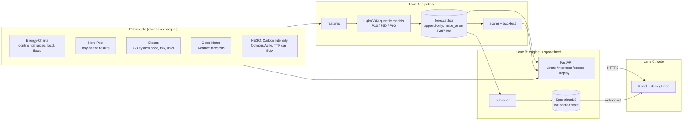
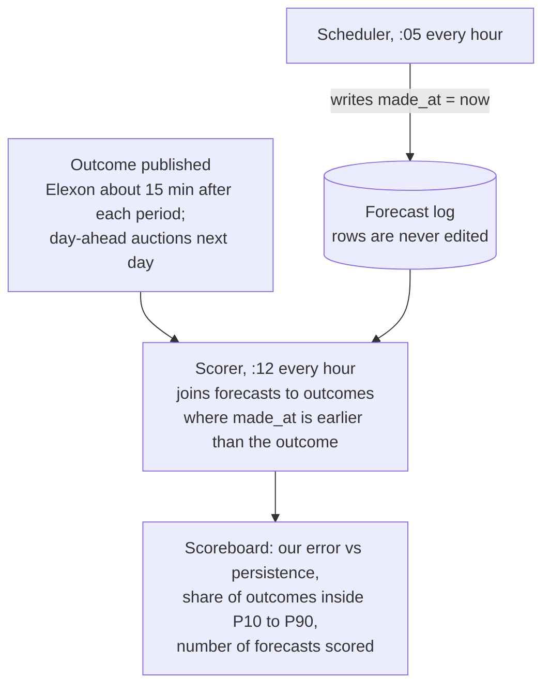

# The Living Grid

A live map of the electricity market in six European zones. It forecasts prices with uncertainty bands, lets you trigger events such as closing the Strait of Hormuz or tripping the Norway cable, and scores every forecast against what actually happened.

Built in 24 hours at HackTheBurgh XIII (7 to 8 November 2026) for the HRT track, "Best Use of Data for Predictions and Decision Making", and the G-Research track, "Making the Unseen Seen".

**Live:** https://htb.stefvuck.dev

## What you can do with it

The site opens with a map of GB, France, Germany-Luxembourg, the Netherlands, Belgium and southern Norway (NO2), coloured by this hour's day-ahead price. Arcs between zones show electricity moving through the interconnectors. On the evening of 7 November the map showed £268/MWh in GB, €322 across the four coupled continental zones and €205 in NO2.

From there:

- **Overview** shows prices, demand, generation mix, carbon intensity and flows for the current hour.
- **Forecast** draws a translucent "ghost" of where prices are heading, with P10 to P90 bands that widen the further ahead you look.
- **Simulate** runs an event and shows what it costs, in pounds or euros, zone by zone.
- **Scoreboard** compares our forecasts with simple guesses. Only forecasts logged before their outcome was known count.
- **Batteries** runs a 1 MW / 2 MWh battery in each zone on our forecasts and compares it with a naive rule and with perfect foresight.
- **Replay** plays back the storm of 26 October 2026 with a model that saw no data from that day onwards.
- **Household** suggests the cheapest window tonight to charge a car or run the dishwasher.

## How it fits together

Three people built it in three lanes. Stefan owned data and models, Keanu the engine and live state, Manu the front end and demo.



Python fetches and caches every source to `data/` as parquet. The forecast scheduler runs at five past each hour, builds features, predicts, and appends to the forecast log. FastAPI answers request-response questions (what was the state at 15:00, what happens if Norway's cable trips). The publisher pushes the latest actuals, forecasts, scores and battery runs into SpacetimeDB every minute, so every open screen updates at once.

## Why you can trust the scoreboard

The pitch rests on one rule: a forecast counts only if it was written down before its outcome existed.



The final Monday forecast freezes at 09:15 UTC on Sunday, before the GB auction closes (09:50 UTC) and the continental auction closes (11:00 UTC). During the 12:30 demo, the reveal view shows the frozen forecast next to the real auction result.

## Results so far

Walk-forward backtest, six folds of seven days each with a 48-hour purge, run on 7 November 2026 at 16:35 UTC:

| Model | Day-ahead price error (MAE) |
|---|---|
| Our LightGBM quantile model | **31.6** |
| Same hour yesterday | 36.8 |
| Last known price when the forecast was made (persistence) | 43.7 |

The model beats persistence by 28% on day-ahead prices. It loses to persistence on NO2 prices and French wind, and the backtest reports those losses rather than hiding them.

The uncertainty bands are too narrow. Across the backtest, 63% of outcomes fell inside P10 to P90, where a calibrated model would catch about 80%. Two single-day replays show where it struggles:

| Day | Hours inside the band |
|---|---|
| 2 November 2026 (calm) | 136 of 168 (81%) |
| 26 October 2026 (storm) | 83 of 168 (49%) |

On 26 October, NESO's data puts GB constraint costs at £36.5M for the day. A recalibration of the bands is task #92 on the board.

## Events you can trigger

| Event | What it changes |
|---|---|
| Strait of Hormuz closes | Raises the gas price; power prices follow through a merit-order estimate where gas sets the price |
| Norway to GB link trips | Removes the link's recent flow: GB residual load rises, Norway's falls |
| French nuclear outage | Removes reactors (default four 1,450 MW units, capped at the 63 GW fleet) |
| North Sea storm or windless week | Scales wind through a turbine power curve (cut-in 3, rated 12, cut-out 25 m/s) |
| Cold snap | Lowers temperature; French demand rises 2,400 MW per degree, RTE's own figure |
| Carbon price spike | Raises the EUA price and passes it through gas plants at 0.334 tCO₂/MWh |
| Storm over Scotland | More Scottish wind than the 6.7 GW B6 boundary can carry: prices fall, but more wind is paid to switch off |

The model learned from two years of history and has never seen a gas shock like a Hormuz closure, so the price change uses a merit-order estimate: a gas plant at 58% efficiency burns 1.72 MWh of gas per MWh of power. The screen says this is an approximation of market coupling.

## Where the numbers come from

Every constant in the engine (interconnector capacities, plant efficiencies, emission factors, wind farm sizes, boundary limits) lives in `engine/reference/facts/` with its source URL, the quote it came from and a confidence rating. Each was researched with the Parallel Task API, checked by a second independent research run, and every figure re-found on the source page with a plain HTTP fetch. 51 of 53 facts pass. The two that do not are marked, and the code refuses to load them.

| Source | Used for | Limit we respect |
|---|---|---|
| Energy-Charts | Continental prices, load, generation, flows | 2 requests per minute per endpoint |
| Nord Pool | Day-ahead prices, including GB (N2EX) | About 60 days of history on the free API |
| Elexon Insights | GB system price, generation mix, interconnector flows, wind curtailment | 7-day windows |
| Open-Meteo | Historical and live weather forecasts | 10,000 calls a day |
| NESO | Constraint costs, boundary flows | Costs arrive about a week late |
| Carbon Intensity API | GB regional carbon intensity | Modelled data, labelled as such |
| Octopus Agile | Household tariff prices | Next day published around 16:00 UK |
| Yahoo Finance | TTF gas and EUA carbon prices | Daily closes, refreshed each hourly run |

## Known limits

- The P10 to P90 bands are too narrow, as above.
- Energy-Charts reports load for all of Norway, not NO2 alone (15.3 GW against roughly 5 GW), so NO2 demand is left blank.
- Ghost wind (wind paid to switch off) is estimated two ways, from accepted balancing bids and from the gap between weather-implied and metered output. Both are labelled as estimates.
- Carbon traced through imports uses standard emission factors per fuel, not plant-level data.

## Running it locally

```bash
uv sync                                    # Python 3.12, fetched by uv
uv run uvicorn engine.app:app --port 8000  # API
cd web && npm install && npm run dev       # front end on :5173
./scripts/check.sh                         # tests, then the web build (the merge gate)
```

`LG_OFFLINE=1` runs the whole app from cached files and committed fixtures, with no network. The demo has to keep working if the venue Wi-Fi drops.

## How we built it

Each person ran one to three Claude Code agents on a 4 GB Hetzner VPS. They took tasks from a shared board (hackhub; see [HACKHUB.md](HACKHUB.md)), each task limited to the files it claimed, and a merge queue landed one task at a time only when tests and the web build passed. Agents in different lanes talked over an ntfy message bus. Main was mirrored to GitHub every minute. By 16:40 on Saturday that process had merged 63 of 89 tasks.

Stack: Python 3.12 with pandas, LightGBM and FastAPI; SpacetimeDB 2.14 for live state; React, Vite, deck.gl 9.4 and MapLibre 5.24 for the map.
